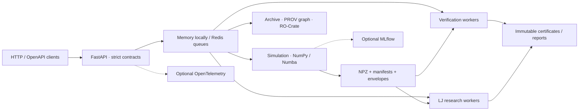

# scientific_fastapi

**Scientific API Gateway — reproducible physics experiments with inspectable results.**

[](https://github.com/Artem7898/scientific_fastapi/actions/workflows/ci.yml)
[](pyproject.toml)
[](LICENSE)
[](https://github.com/Artem7898/scientific_fastapi/releases/latest)
[](https://github.com/Artem7898/scientific_fastapi/releases)
[](#development)

**English** · [Русский: подробное руководство](README.RU.md) · [API reference (RU)](docs/api_reference.md) · [Architecture (RU)](docs/architecture.md)

Submit a seeded simulation, follow its progress, and retain the arrays, model contract, environment metadata and checksums behind the result. FastAPI handles HTTP; NumPy and optional Numba run the physics.

| You need | The project provides |
| --- | --- |
| Reproducible experiments | Explicit PCG64 seeds, versioned models, frozen dependencies and saved states |
| Work beyond one HTTP request | Bounded queues, standalone workers, SSE, cancellation and opt-in checkpoints |
| Inspectable evidence | Result Envelopes, archived provenance, RO-Crate export and independent verification |
| Scientific comparisons | Ensembles, saved-data analysis and conditional LJ uncertainty workflows under review |

> [!NOTE]
> This README describes the current source tree. The published **v2.0.0** release predates several features below; its contract is documented in the [release notes](docs/releases/v2.0.0.md).

## 🚀 Quick start

For a fresh local deployment, install Git and a recent Docker Compose v2. No `.env` file or external Redis setup is required.

```bash
git clone https://github.com/Artem7898/scientific_fastapi.git
cd scientific_fastapi
docker compose up --build --detach --wait api redis
```

Open **[Swagger UI](http://localhost:8000/docs)** or [ReDoc](http://localhost:8000/redoc). The API binds to `127.0.0.1:8000`; Redis and artifacts use named volumes. Initial image building downloads locked dependencies.

Submit a small interacting-particle experiment:

```bash
curl -fsS http://localhost:8000/api/v1/simulations/lennard-jones \
  -H 'Content-Type: application/json' \
  -d '{"num_particles":16,"box_size":[8.0,8.0],"num_steps":40,"sample_stride":2,"seed":42}'
```

The **202** response supplies `task_id` and `check_url`. Poll `check_url` until terminal status; after `completed`, download the manifest and scientific state. All operations are also interactive in `/docs`.

<details>
<summary>Local Python installation and optional integrations</summary>

Use Python **3.12+** and [uv **0.12.23**](https://docs.astral.sh/uv/), as pinned by the project. Distribution: `scientific-api`; import: `scientific_api`.

```bash
uv sync --frozen
uv run --frozen --no-sync uvicorn scientific_api.main:app --host 127.0.0.1 --port 8000
```

This starts the NumPy core with process-local memory storage. Install extras explicitly: `redis`, `numba`, `tracking` (MLflow), `observability` (OpenTelemetry), `research` (Matplotlib PNG/PDF), `notebooks`, `benchmark`, `dev`.

```bash
uv sync --frozen --extra redis --extra numba --extra observability
```

Memory queues are for one process; Redis and shared artifact storage support separate processes. See the [configuration and upgrade guide](docs/development.md).

</details>

## 🧪 Models and applications

| Model | What it calculates | Useful for |
| --- | --- | --- |
| `ideal-gas-ou-v1` | Exact 2D OU velocity transitions, kinetic temperature and energy | Teaching stochastic dynamics and checking analytic estimators |
| `langevin-free-v1` | Positions, constant acceleration, drift, MSD and gated diffusion estimates | Transport-method experiments with independent particles |
| `lennard-jones-2d-v1` | Periodic 2D LJ; NVE velocity Verlet or NVT BAOAB; energies, pressure and RDF | Testing interacting-particle algorithms and finite numerical experiments |

Models use **reduced units** with $k_B=1$. Material properties require an explicit physical calibration. LJ initialization has fixed kinetic temperature and zero center-of-mass motion; equilibration is a separate scientific question.

<details>
<summary>One analytic reference and its scope</summary>

For the independent equilibrium snapshot in `ideal-gas-ou-v1`,

$$
\operatorname{SE}(\widehat T)=\frac{T}{\sqrt N}.
$$

This formula describes that model's terminal temperature estimator. Interacting LJ particles and consecutive frames require their own correlation-aware analysis. Read the [scientific assumptions and limitations](docs/architecture.md).

</details>

## Architecture



The API validates requests; workers own numerical execution. Simulation files, lifecycle provenance and later verification/research outputs remain distinct. Redis coordinates deliveries; multiple machines also need shared artifact storage. [Implementation boundaries](docs/architecture.md) keep the numerical core independent of HTTP and tracking.

For separate processes, use [compose.worker.yml](compose.worker.yml): `api`, simulation `worker`, `verification-worker` and `research-worker`. The default `embedded` mode runs the consumers locally. Saved-velocity PNG/PDF generation uses a bounded API-process pool.

## Evidence and research workflows

Routes below are relative to `/api/v1`; replace the IDs with returned values.

| Purpose | Endpoint |
| --- | --- |
| Inspect model contracts | `GET /models` |
| Follow progress / request cancellation | `GET /simulations/{id}/events` · `POST /simulations/{id}/cancel` |
| Recheck saved result integrity | `GET /simulations/{id}/envelope` |
| Inspect lineage / retain files offline | `GET /provenance/tasks/{id}/graph` · `GET /provenance/tasks/{id}/export` |
| Continue a compatible interrupted run | `POST /simulations/{id}/resume` |
| Independently verify a result | `POST /simulations/{id}/verifications` |
| Analyze saved LJ data — development branch | `POST /research/lj/analyses` |

Checkpoints are opt-in through `CHECKPOINT_INTERVAL_STEPS`; compatibility conflicts are explicit. Verification has a separate queue and unsigned certificate: `completed` is job state, while `passed`, `failed`, `inconclusive` and `unsupported` are scientific-check verdicts. A checksum establishes agreement with recorded bytes; it does not establish authorship or experimental validity.

The LJ research work in this branch uses conditional **batch-means Student-t intervals** for time series; moving-block-bootstrap summaries are explicitly exploratory. It also compares whole replicas and matched-seed parameter groups. Intervals require adequate data and stated assumptions; a completed analysis can report an unavailable interval with a reason. See the [calibration report](docs/validation/lj-uncertainty.md) for measured scope and the [API reference](docs/api_reference.md) for diagnostics and budgets.

## ⚡ Measured performance and resource use

One **1024-particle × 20-step** LJ benchmark on AMD EPYC 9V74, using five warm samples:

| NumPy direct | NumPy cell-Verlet | Numba direct | Numba cell-Verlet |
| ---: | ---: | ---: | ---: |
| 1,218.096 ms | 40.006 ms | 41.925 ms | 21.209 ms |

These are engine medians including initialization and neighbor construction, excluding HTTP, queueing, RDF and artifact I/O. Density, cutoff, workload and compilation costs matter. The [raw measurements and scope](docs/benchmarks/lj/README.md) and [full-service CPU benchmarks](docs/benchmarks/README.md) explain the tradeoffs.

LJ admission bounds include **4096 particles**, **20 million particle-steps**, **1001 saved frames** and **64 MiB of trajectory coordinates**; additional physics/pair-work limits apply. These are admission limits, not latency guarantees.

Resource-conscious execution uses bounded particle-step/pair-work budgets, sampled trajectories, cooperative cancellation and reanalysis of saved data. Energy/carbon measurements are future work. Production backends are CPU NumPy/Numba. JAX is a benchmark-only CPU experiment; GPU execution and free-threaded Python require targeted validation.

## Operations, security and observability

- **Integrity and admission:** strict finite inputs, explicit backend selection, bounded queues, owner-fenced commits, atomic artifacts and bounded no-pickle NPZ readers.
- **Container defaults:** pinned base images, an unprivileged runtime user and loopback host ports. Retain both Redis and artifact volumes when upgrading.
- **Observability:** opt-in OpenTelemetry traces HTTP/queues/computation; metrics cover HTTP and simulation wait/run/outcomes. Logs use standard Python/Uvicorn handlers; configure JSON formatting in deployment. MLflow tracking is optional.

Public deployment requires your gateway's authentication, TLS, user quotas and network/storage policy. [Operational configuration](docs/development.md) documents execution roles, retention and exporters.

[](.github/workflows/ci.yml)
[](.github/workflows/ci.yml)
[](.github/workflows/ci.yml)

| Quality signal | Published evidence |
| --- | --- |
| CI | Python 3.12–3.14, numerical references, Redis recovery, wheel and Docker checks |
| Test coverage | No coverage percentage is produced by the repository CI |
| Security / OpenSSF | No vulnerability-scan report or Scorecard workflow is committed; no score is claimed |

## Roadmap · 2026–2027

| Area | Status |
| --- | --- |
| Scientific core, reports, workers, ensembles, NumPy/Numba, transport and LJ | Implemented in the source history |
| Contracts, provenance, checkpoints and independent verification | Implemented; stages 1–9 merged into `main` |
| Conditional LJ uncertainty and sensitivity — stage 10 | Implemented in this branch; conditional intervals with scoped calibration |
| Authenticated users/agents, per-principal quotas, signed attestations and MCP | Proposed next infrastructure work |
| Slurm, GPU execution or browser/Wasm experiments | Exploratory; require a concrete deployment need and measured validation |

Stage 10 completes the agreed ten-stage scientific plan. The proposed items above are future directions, not additional agreed stages.

<a id="development"></a>

## Development and contributing

Use an issue to describe a bug, experiment or proposed scientific contract; keep pull requests focused and include validation for numerical changes.

- Version changes to model/RNG semantics and add reference or regression checks.
- Change dependencies and `uv.lock` only within an explicit dependency-update scope.
- Preserve committed source artifacts; publish derived analyses as separate records.
- Run the checks below, including real Redis tests for queue or recovery changes.

```bash
uv sync --frozen --extra dev --extra redis --extra tracking --extra research --extra observability --extra numba
uv run --frozen --no-sync ruff check .
uv run --frozen --no-sync ruff format --check .
uv run --frozen --no-sync pyright
uv run --frozen --no-sync pytest
```

A disposable Redis URI in `SCIENTIFIC_TEST_REDIS_URI` enables the persistent-queue tests. See [development](docs/development.md), [benchmarks](docs/benchmarks/README.md) and the [changelog](CHANGELOG.md).

AI-assisted changes are produced under maintainer direction and must meet the same review and validation requirements as other contributions. Cursor, Windsurf, Claude and other assistants can use the repository and its OpenAPI contract as development inputs. Compatibility here means working from documented files and HTTP contracts; the runtime uses the declared Python dependencies. Documented diagram text and meaningful links support reading without relying on color or animation.

## License, citation and contact

Code is [MIT licensed](LICENSE), © 2026 Artem Alimpiev. Research-output licensing follows its own metadata. Cite the project through [CITATION.cff](CITATION.cff) and GitHub's **Cite this repository** action.

[Artem Alimpiev](https://github.com/Artem7898) · [ORCID](https://orcid.org/0009-0007-6740-7242) · [Issues](https://github.com/Artem7898/scientific_fastapi/issues) · [Email](mailto:alimpievne@gmail.com).

Built with [FastAPI](https://fastapi.tiangolo.com/), [NumPy](https://numpy.org/), [Numba](https://numba.pydata.org/), [uv](https://docs.astral.sh/uv/) and [Redis](https://redis.io/), with optional [OpenTelemetry](https://opentelemetry.io/), [MLflow](https://mlflow.org/) and [Matplotlib](https://matplotlib.org/).
